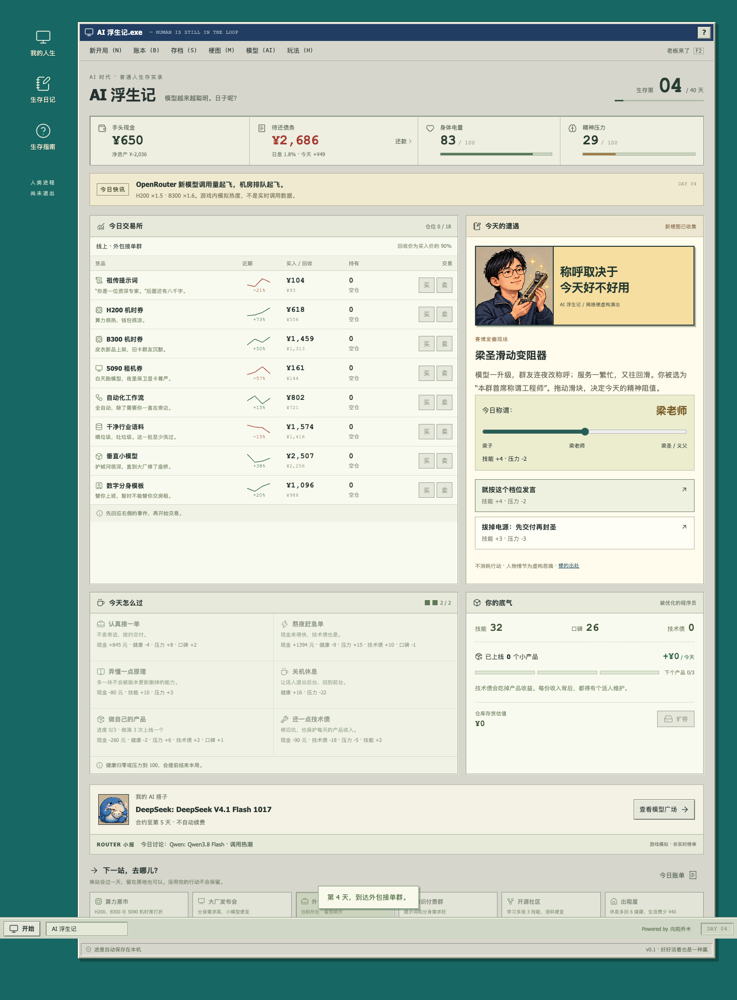

# AI 浮生记

**模型在进化，你还好吗？**

带着 8,000 元培训贷，进入人人都说自己快要被 AI 替代的时代。你有 40 天：倒腾算力、接单、学原理、做产品，也得吃饭睡觉。梁圣的称呼可以滑动，房租不会。

[开始游戏](https://fusheng.qiaomu.ai/) · [研究出处](docs/RESEARCH.md) · [梗图清单](docs/MEMES.md) · [模型版本](docs/MODELS.md) · [English](#english)



## 能玩什么

- 40 天生存交易，5 种身份（被优化的程序员、AI 自媒体、一人公司 CEO、普通打工人、应届 AI 原住民），各有真实数值加成；8 个站点、20 类 AI 圈商品（每站每天交易其中 8 种）（邀请码、Claude 拼车位、AI 副业课……），每天 2 格行动。
- 开局直接安排工作，遭遇可选且不挡操作；每天常驻通关目标与下一步说明。每次行动有过程动画、结果插图、随机暴击或翻车，赚钱有金币声和飘字，菜单可静音。到站有早报：车马费 500/800/1000 随机、黑客松奖金、房东涨租，外加当日头条和“本站突发”暴涨暴跌。
- 写稿发帖是抽卡：10 万+、六指图翻车、被限流，或者熬夜住院。全部美术为 Codex 生成的原创像素画：5 张身份立绘、8 个地点、16 张新闻与抽卡插图、8 个货品图标。
- 107 个日常事件、5 个阶段剧情、5 个条件后续；72 张可收集梗图（含 Claude 封号与降智、DeepSeek 节前发版、相亲对象让你写周报、35 岁面试、AI 女友提醒续费）：大肥鱼吃白饭、服务器繁忙、用户彻底怒了、草莓数 r、皮衣显卡、烤肉酱、Claude 钨块小卖部……
- 梁文峰、黄仁勋、马斯克、扎克伯格、奥特曼、达里奥以虚构恶搞角色出场。9 格原创像素插画，搭配事件字幕。
- 22 个可签约搭子，每家最多两个，含 Meta Muse App、Grok Bot、OpenAI Dots 三个 Agent 应用；按口碑单独定价（¥45–¥600），不是现实能力榜。合约使用游戏币，最多五天，不自动续费。
- H200 / 5090 机时、B300 排队票、Mac mini 养虾套装、Token 急救包、祖传 SKILL.md、MCP 接头、榜一截图、Agent 外置记忆、钨块等交易，OpenRouter 调用热潮、AA 榜单换位、新模型发布会改变行情。报价和流量为游戏模拟。
- 180 条原创小报头条与 180 句锐评，一局 40 天同题材间隔至少 3 天；养 Claw 分期买 Mac mini、Token 贷与限额试养走向不同后续。[研究与玩法建议](docs/NEWS-RESEARCH.md)。
- 每种身份有 6 种轮换职业单，报酬按各自技能 / 口碑权重计算；热点职业报价 +30%，AI 搭子在行动里显示加成。第 40 天清算后债清、人还在即通关，三条出局线见游戏规则。
- 出局首屏说明原因、前后数值和最后一步，危险操作先提示概率。全服榜支持昵称主动提交、服务器重算成绩；保留本机纪录。
- 自动存档、JSON 导入导出、结局 PNG、离线续玩，以及 F2「老板来了」。适配手机。

人物对白和商业情节为虚构讽刺。本作不调用真实模型接口，没有付费功能。日常进度保存在本机；主动提交全服榜时才上传昵称和本局操作用于核算，公开展示昵称与成绩，不保存完整操作。公开网站使用 Umami 统计访问。

## 本地运行

Node.js 24+：

```sh
npm ci
npm run dev
# 另开终端，启动可选的全服榜服务（默认 3491 端口）
npm run server
```

```sh
npm test             # 按需手动运行引擎检查，默认不跑整局模拟
npm run test:e2e     # 按需手动运行完整浏览器检查
npm run build       # dist/，含按内容哈希版本化的离线缓存
npm run package     # release/ai-fushengji-0.7.0-web.zip
```

本地浏览器测试默认使用 Chrome。CI 使用 Playwright Chromium；可用 `CI=1 npx playwright install chromium` 安装后运行。`TEST_URL` 可覆盖待测地址。

更新模型目录：`npm run refresh:models`。然后人工审阅 `src/models.js` 的主阵容，核对官方来源，并更新日期和文档。Command / Cohere 会在刷新时被过滤。

## 实现与验证

原生 JavaScript + Vite + Lucide。引擎为纯状态转换，RNG 随存档保存，刷新不能重抽报价或风险结果。低买高卖有 10% 价差；第 40 天仍可行动，最终清算只结一次账。非法输入不改变状态，导入校验不通过不覆盖当前局。

v0.7.0 完成本地构建、失败与榜单接口抽查，以及 1365px 桌面 / 390px 和 320px 小屏结算与提交操作检查。按用户要求未重跑整局、全套用例或多种子平衡模拟。CI 默认只构建，完整检查需手动选择。实际难度与乐趣仍需玩家反馈。

游戏可独立静态部署；全服榜另有 Node.js + SQLite 服务，见 [部署说明](docs/DEPLOYMENT.md)。保留 [设计记录](DESIGN.md) 和 [规则](docs/GAME-DESIGN.md)。

## 来源与许可

灵感来自 [郭祥昊《北京浮生记》](https://github.com/chrisguo/beijing_fushengji)，未使用原作代码、文本或美术。代码与原创内容采用 [MIT](LICENSE)。人物与品牌名称属于其权利人，不表示合作或认可。图片为本作生成的原创像素插画；第三方梗图仅提供研究链接，没有搬运打包。

作者：[向阳乔木](https://qiaomu.ai/) · [X](https://x.com/vista8) · [乔木推荐](https://tuijian.qiaomu.ai/)

## English

**AI Life Simulator** is a free, Chinese-language, single-player browser game inspired by the 40-day survival and trading loop of *Beijing Fushengji*. Trade GPU time, pay off training debt, deliver client work, build small products, and protect your health in a rapidly changing AI economy.

It includes 107 everyday events, 5 milestones, 5 conditional follow-ups, 72 collectible meme cards, 180 news editions, and 22 model companions. Public AI figures appear in clearly fictional satirical scenes. All prices, model bonuses, leaderboards, and traffic changes are game mechanics rather than real-world claims. No model API or API key is required.

Local saves, import/export, ending-card PNG export, mobile layouts, and offline play are supported. Optional leaderboard submission sends a nickname and command replay for server verification; scores are public, complete command records are not retained. The public site uses Umami for page analytics. Use Node.js 24+, `npm ci`, and `npm run dev`; `npm run server` starts the optional leaderboard. Full tests are opt-in. Code and original content are MIT licensed; no original Beijing Fushengji assets are reused.

## 单屏玩法

目标和下一步始终可见：看新闻 → 自选两次职业安排 → 收工，默认免费换站；打车 ¥120 可跳站，原地停留免费。遭遇可选，交易和还款不限次数。桌面三栏；窄屏按钮切换，长内容点按钮翻页，无需上下左右滚动。完整模型与梗图内容保留。调研与布局验证见 [UX-RESEARCH.md](docs/UX-RESEARCH.md)。

已打开的旧版本页面可使用浏览器强制刷新（macOS：⌘⇧R），或关闭此站全部标签后重新打开；无需清除存档。
